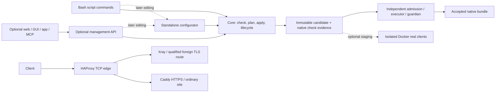

# HTON architecture

Current 2026-11-06 planning authority: [M1 implementation plan](plans/INSTALLATION-IMPLEMENTATION.md).
It freezes OR-37–OR-45 and supersedes conflicting older design/default descriptions
below; historical source/build/test observations remain historical evidence. No
new M1 product implementation, build or acceptance is claimed.

Design revision: 2026-10-31. This repository is a scaffold; this document describes
target behavior, not verified operation. [Owner requirements](OWNER-REQUIREMENTS.md)
prevail over derived specifications. [Decisions](DECISIONS.md) distinguish owner
requirements from engineering choices. [Final audit](FINAL-REVIEW.md) records limits.

> **Target project split (OR-68, 2026-11-12).** In the target architecture the
> public edge — HAProxy, Caddy, ACME certificates, the ordinary site, public
> TCP/80/443/853, route policy, backend pools and health checks — belongs to the
> independent **Triodos** project. **Onomat** owns the VPN service under
> `hton/services/`, including engines, protocol configuration, private listeners
> and data-plane lifecycle. HTON is the server platform that manages this and
> other services. Onomat also owns the Unbound work per OR-69/OR-70.
> The edge sections below describe the **pre-split M1 path**, which remains the
> working data plane until the migration cutover. They are preserved as the
> source of the extraction, not as the target ownership. The split design,
> contract and phases live in the Triodos project's `docs/`; see
> [OR-68](OWNER-REQUIREMENTS.md#or-68-split-the-public-ingress-into-triodos-2026-11-12),
> [OR-69](OWNER-REQUIREMENTS.md#or-69-server-client-platforms-onomat-owns-vpn-2026-11-13)
> and [D176/D177](DECISIONS.md). No runtime cutover is authorized by this note.

## 1. Availability and execution model

The ordinary site and selected VPN engines run on accepted native configurations
without calling Core, the configurator, management API, web UI or an accounts database.
Their cold boot uses cached pinned images and accepted artifacts. Management failure
must not stop them. Separate Compose projects, systemd units and resource limits
isolate management. This does not protect against root, disk, kernel or Docker failure.

Core is mandatory installed logic, invoked directly by Bash `scripts/*`; it need not be
a resident management daemon. Runtime is the small privileged executor/guardian.
The optional full management API delegates to Core and the future configurator.
Web administration is a separate later Docker module and always uses that API.
No daemon per protocol or per internal code module is required.

Runtime never imports the compiler/configurator/API. Native validation is required;
Docker candidate staging is optional. Actual protocol clients qualify each shipping
module; that release evidence is distinct from testing every individual apply.

## 2. Configuration and module contracts

The editable tree is `/opt/hton/config/`, separate from code and working state:
`hton.yaml` owns platform settings and `features.<id>.enabled`; each installed module
has `modules/<id>.yaml` with `schemaVersion`, `moduleId` and `settings`. Editable deployed Docker
configuration lives in `docker/`, protected secret versions in `secrets/`. Shipped
templates stay in the protected distribution. There is no parallel live `.env` source.
The root and module files form one desired snapshot; validation reads them together.
See [configuration SDD](specs/sdd-config.md) and [configurator SDD](specs/sdd-configurator.md).

Versioned descriptors declare dependencies, checks, shared services, privileges,
listeners/routes, format versions, state ownership and lifecycle/update adapters.
Settings and named objects use nested mappings with stable identifiers; lists have
explicit ordering/update semantics. Missing fields receive versioned defaults;
explicit false, zero and null are never overwritten by defaults. Unknown values
are preserved for diagnosis; they cannot silently become active engine parameters.

A module provides its semantic checker. Core aggregates schema, module and global
checks, including dependency cycles, wildcard bind overlaps, SNI/path ownership,
secret availability, approval envelopes and Docker customization constraints.
Several protocols share Xray/Caddy; engine closure is computed, not persisted as
another feature selection. Disabling one consumer retains engines needed by others.
Descriptors are trusted shipped integrations, not arbitrary code supplied in YAML.
Use unmodified upstream images where possible; HTON logic lives outside them.

## 3. Storage and ownership

Paths below are an engineering binding of the owner's storage requirements.

| Path | Authority and preservation |
|---|---|
| `/opt/hton/` distribution files | Protected code/templates; only controlled upgrade changes them |
| `/opt/hton/config/hton.yaml` | Editable platform configuration and desired enabled selection |
| `/opt/hton/config/modules/<id>.yaml` | Module-owned versioned settings |
| `/opt/hton/config/docker/` | Editable deployed Docker inputs; preserve customization |
| `/opt/hton/config/secrets/` | Protected versioned secret material; resolve by logical secretRef |
| `/opt/hton/config/**/<name>.deprecated.yml` | Protected preserved originals of transformed/unsupported values |
| `/opt/hton/work/registry.json` | Explicit installed/associated composition, setup progress, resource identity and ownership |
| `/opt/hton/work/runtime/` | Accepted/previous bundle IDs, durable run intent, lease and recovery fences |
| `/opt/hton/work/bundles/<id>/` | Immutable native configs, effective Compose, pins and validation evidence |
| `/opt/hton/work/journal/` | Durable intent, protected originals, effect records and compensation |
| `/opt/hton/work/data/` | Identity metadata and service persistent data with separate permissions |
| `/opt/hton/work/acme/`, `work/certs/` | Issuer account/candidates and validated certificate inventory |
| `/run/hton/` | Re-creatable sockets and short-lived locks; never sole durable run intent |
| `/var/logs/hton/` by default | Installer-configurable logs with mandatory bounded rotation and one-week retention |

`config/` and `work/` are excluded from Git. Code protection does not make
configuration and data share permissions. The durable, non-regenerable material is
the separate private `.secrets` repository (`profile.yml`, `images.lock.json`,
`share/`); `config/` is materialized from it, and `work/` is reconstructible.
Recovery means checking out that private repository, running `scripts/install`,
then `scripts/up`; R1 has no separate backup/restore mode or backup store.

## 4. Lifecycle and associated foreign resources

The catalogue says what is available. The registry says what has been installed or
explicitly associated. YAML says which installed modules should participate. Runtime
observation says what is actually running. None is inferred from another.

`modules add` obtains resources and resumes setup but leaves a new module disabled.
Incomplete setup is durable and cannot start. `enable/disable` changes participation,
checks a combined candidate and applies by default, with interruption preview; an
explicit save-only mode batches changes. `remove` excludes the module and preserves
data. `purge` is separate explicit destruction. `modules update` updates images via
the module's declared update logic; `up` never pulls or upgrades.

`up` validates desired configuration, enables autostart and starts missing members
of the saved enabled composition. Healthy members remain running on partial failure.
Invalid desired config requires a separate explicit last-known-good action; it is
never silently substituted. Accepted automatic boot is independent of editable YAML.

`down` persists stopped intent before stopping every associated resource, including
adopted Amnezia. It disables all relevant restart owners, continues after errors,
and lists survivors. Recovery/renewal/watchers must not revive a stopped server.
Only verified complete shutdown permits an off result. The guardian cannot override
a later stop intent. See [lifecycle SDD](specs/sdd-lifecycle.md).

Amnezia retains configuration and certificate ownership while delegating agreed
whole-server start/stop to HTON. Discovery alone confers no authority. Adoption
records exact resources and original restart policies; unsupported lifecycle control
blocks adoption. Owner D80 accepts native REALITY via byte-preserving passthrough,
with the genuine own-domain HTTPS certificate on the ordinary site. Qualify exact
installed native identity/SNI/target/restart behavior before shared-443 integration;
do not confuse REALITY authentication with conventional TLS termination. No extra
Amnezia certificate manager. See [primary-source evidence](AMNEZIA-NATIVE-EVIDENCE.md).
External VPN-client routing/uplink remains outside this server repository until a
new integration decision; server `up/down` never controls that external client.

## 5. Ingress and network

HAProxy classifies bounded TCP ClientHello: exact qualified foreign/REALITY routes,
exact MTProto routes, then ordinary valid own-domain TLS to Caddy. No-ALPN is not
protocol identity. Unknown SNI, missing SNI, ECH, malformed/fragmented input and
timeouts need explicit tested outcomes; conflicting raw/wildcard assignments fail.
Never issue certificates for arbitrary third-party names or guess non-TLS Outline.
OR-38/39 use separate configured protocol names. Exact assignments precede the
OR-43 owned-wildcard redirect exception; all other unknown names are rejected at
the edge. OR-44 reuses one existing Caddy: it serves `/var/www/html`, a simple 403
for ordinary browser TLS on the REALITY name, and 308 redirects from unassigned
covered wildcard subdomains to the apex. REALITY's failed-verification path targets
that private Caddy TLS listener directly, without a new HTTP server or MTProto hop.
Existing legacy profiles/chains change only through a reviewed OR-36 transition.
Owned public ingress is TCP/443 and, when selected, UDP/443; never public 8443.
A single UDP/443 owner must qualify QUIC behavior independently of TCP SNI routing.
See [security review](SECURITY-MASKING-REVIEW.md) for observed DNS gaps, native
backend limits and the final evidence scope.

Caddy serves own HTTPS, ordinary site, selected WS/XHTTP/CONNECT paths and optional
admin paths. Absent/stopped/unresolvable admin cannot break edge startup or reload.
Disabled routes are omitted; an enabled unavailable admin branch fails locally.
The ordinary placeholder site is independent of admin. DNS-01 needs no HTTP ACME
route. Backends listen on private container interfaces, without public publishing.
A foreign host-loopback backend needs a separately qualified scoped relay topology;
Docker host-gateway alone does not reach host loopback.

R1 uses IPv4. UDP protocols retain explicit endpoints and constraints; UDP/443
cannot simultaneously belong to Hysteria, HTTP/3 and a foreign service. IPv6,
strict egress-family selection and traffic accounting are far-future work; accounting
is excluded from R1/R2. Router/client installation is incremental and optional.

## 6. Apply, recovery and certificates

Read a coherent desired snapshot -> normalize/check -> plan exact affected effects
-> lock/recheck -> persist intent -> render immutable final bundle -> native checks
-> optional isolated staging -> independent admission -> guarded trial -> verify
-> accept or compensate. Hashes cover editable Docker inputs, secrets and catalogue
versions. Untouched service hashes cause no restart. Reload/recreate behavior and
possible disconnections are explicit. Read-only dry-run never writes or pulls.

Accepted artifacts are immutable; editable Docker files are inputs, never active
mounts. Invalid customization cannot bypass admission. Config locks do not remain
held while waiting for runtime trial; runtime lease/effect lock allow independent
recovery from killed or hung management. Stop intent takes precedence over rollback.
Fallback must respect current revocations and certificate validity; future strict
family fences apply only when that feature exists. First install uses an explicit
pre-install rollback target. No general autonomous self-repair requirement is added.

Own certificates use a short-lived pinned acme.sh DNS-01 job and persistent timer,
one issuer, validated candidates and scoped delivery. Down suspends automatic HTON jobs; explicit manual certificate preparation while stopped does not start VPN. Domainless installation is allowed as unpublished/degraded state;
installer explains domain setup and applicable blocking risks. A public own-domain
VPN/site cannot be declared ready without trusted matching certificates.

## 7. Delivery and architectural improvements

R1 delivers standalone CLI/Core, manual YAML validation/safe apply, resumable module
lifecycle, durable shutdown/autostart, IPv4 ingress/site/Xray and qualified existing
Amnezia integration. API/configurator interfaces are designed now; their full
implementation, web and personal cabinets follow later. Automatic editing/merging,
format migration and full upgrade are deferred. R1 does not depend on them.

The important simplifications are one Core apply path, one registry, one validation
contract and one immutable runtime contract. A standalone configurator hides merge,
format migration and recovery complexity behind parameter-batch operations; CLI and
future API reuse it. The runtime hides native effect/recovery details without importing
management. Keep internal seams small; no speculative message bus, cluster or generic
plugin framework. Build artifacts outside the target 1–2 GB VPS. Measure actual
resources; 50 devices/tens of connections are a target, not certified capacity.

## 8. Implementation module boundaries

| Module | Interface / responsibility | Excluded responsibility |
|---|---|---|
| Bash scripts/lib | Fixed dispatch, bootstrap, interactive guidance/consent | Separate business logic/parser |
| Core config/catalog/checks | Coherent snapshot, normalization and aggregated checks | Automatic editing/migration |
| Core registry/lifecycle | Install/adopt/setup progress and whole-server transitions | External client routing |
| Core plan/render/apply/journal | Exact effects and recoverable runtime proposals | Broad Docker forwarding |
| Standalone configurator, deferred | Read/diagnose, atomic parameter batches, preservation/migration | Being required for R1 or accepted boot |
| Optional management API | Full typed operations, tokens, durable job/results and authorization | Alternate config/apply semantics |
| Optional admin/web | Presentation, authenticated drafts and personal cabinets | Direct YAML/secret/Docker writes |
| Runtime | Admission, scoped execution, run intent, lease, accepted boot/recovery | Compiler/configurator/API imports |
| Trusted adapters | Module checks and declared lifecycle/update effects | Undeclared resources or second desired store |

These are responsibility seams, not one daemon per row. The [file map](sdd/map/README.md)
and machine graph bind interfaces to proposed files; extensions remain replaceable.
